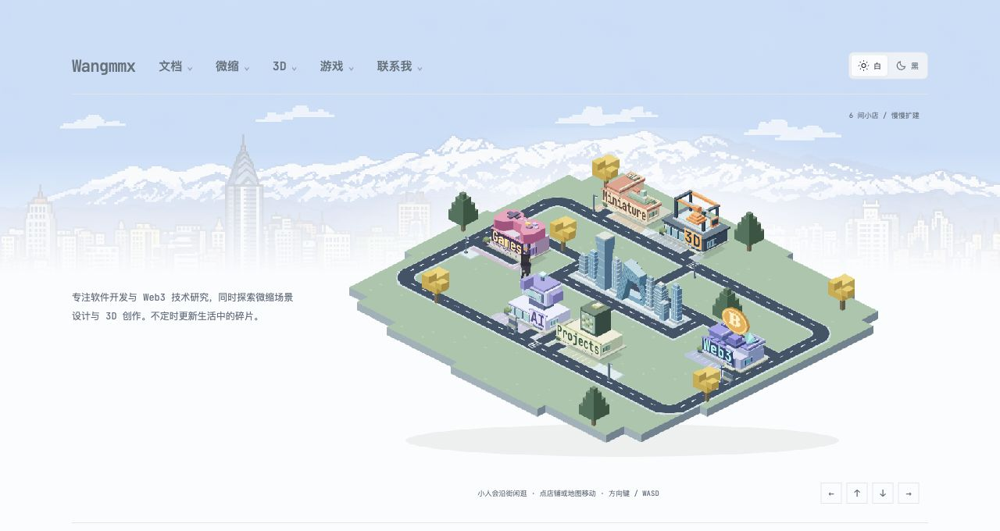

# Wangmmx · 个人空间

这是一个个人博客和作品集，记录软件开发、Web3、AI、微缩场景、3D 创作和游戏。首页以北京 CBD 为灵感设计了一座互动像素街区。访客可以点击店铺查看主题介绍，也可以用方向键或 WASD 操控街区里的角色。站内还有文章、图片和小作品合集。

[访问网站](https://wangmmx.github.io/)

## 首页预览

## 两个仓库怎么配合

| 仓库 | 用途 |
| --- | --- |
| `blog-source`（私有） | Jekyll 源码仓库，维护 Markdown 文章、Liquid 模板、站点配置和前端资源。 |
| `Wangmmx.github.io`（本仓库） | 公开发布仓库，存放构建后的 HTML、CSS、JavaScript 和图片。GitHub Pages 从 `main` 分支根目录发布这些文件。 |

在 `blog-source` 修改内容后，先用 Jekyll 构建，再把生成的文件手动同步到本仓库。检查变更、提交并推送本仓库的 `main` 后，GitHub Pages 会部署新版。

## 技术点

- **静态构建**。Jekyll 用 Liquid 模板将 Markdown 文章和站点数据生成首页、文章列表与分类页，并输出 Atom 订阅和站点地图。
- **互动街区**。原生 JavaScript 使用 Canvas 2D 绘制等角像素场景，结合网格寻路与碰撞检测控制角色移动，并通过 `requestAnimationFrame` 更新动画。
- **页面交互**。CSS 自定义属性实现明暗主题，`localStorage` 记住选择。导航使用原生 `
`，相册使用 `<dialog>` 展示大图。
